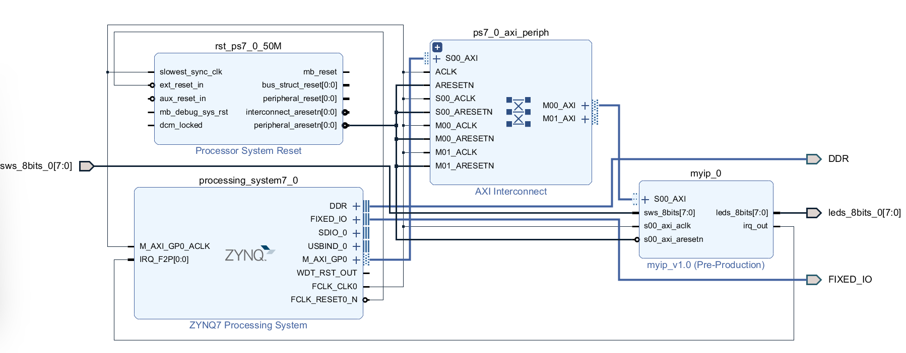

# HW2.1 - Zynq7020 Interrupt Control

## 作業題目

延續HW2第三題，將內建GPIO改成自訂IP，並由硬體部分控制，軟體部分僅提供中斷訊號

# 題目三(自訂IP) ANS
# Hardware Design

## Vivado Block Design



# 系統晶片設計實習：自訂 AXI4-Lite IP 跑馬燈與中斷控制設計報告

## 1. 系統整體架構 (System Architecture Overview)

本專案移除 Xilinx 官方的 AXI GPIO IP (`axi_gpio_0` 與 `axi_gpio_1`)，改採以 Verilog 完全自訂之 `myip_v1_0` Custom IP，並與 Zynq-7020 PS (Processing System) 進行 AXI4-Lite 匯流排連接與硬體中斷對接[cite: 1, 4, 5]。

```text
【Zynq-7020 PS 端 (ARM CPU)】
       │
       ├── AXI4-Lite 匯流排 ───> 【myip_0 (Custom IP - PL 端)】
       │                            ├── 時脈分頻器 (slow_clk) ──> 跑馬燈正反向控制邏輯
       │                            ├── slv_reg0 (0x00) ───────> (保留供 CPU 控制)
       │                            ├── leds_8bits[7:0] ───────> [XDC] ──> 實體 8 顆 LED
       │                            ├── sws_8bits[7:0]  ───────> [XDC] ──> 實體 按鈕/開關
       │                            │     └── sws_8bits[7] ────> 跑馬燈方向控制 (0:正向, 1:反向)
       │                            └── slv_reg2 (0x08) ───────> 中斷手動清除邏輯
       └── IRQ_F2P[0:0] <────────── irq_out (硬體中斷訊號線)
```
## 2. 硬體架構與 RTL 設計 (Hardware RTL Design)
本 IP 採用 雙層階層化設計 (Hierarchical Design)：

頂層模組 (myip_v1_0.v)：作為 IP 的外包裝門面，負責宣告與外部開關、LED 及 PS 端 IRQ 腳位的連線，並將 AXI 匯流排訊號直接透傳給底層。

內層邏輯模組 (myip_v1_0_S00_AXI.v)：包含 AXI4-Lite 暫存器讀寫對映、跑馬燈計數器與中斷手動觸發/清除邏輯。

#RTL 暫存器與 I/O 位址規劃 (Register Map)

|    暫存器 / 腳位   | 位址偏移量 (Offset) |       讀/寫權限    |                       功能與邏輯說明                       |
| ----------------- | ------------------ | ------------------ | -------------------------------------------------------- |
|  leds_8bits[7:0]  |          -         |       輸出 (O)     |        連接實體 LED，由內部跑馬燈邏輯與分頻時脈驅動。        |
|  sws_8bits[7:0]   |   0x04 (slv_reg1)  |       讀取 (R)     | 讀取 8 位元指撥開關/按鈕狀態。sws_8bits[7] 控制跑馬燈方向。  |
|      slv_reg2     |         0x08       |       寫入 (W)     |   中斷清除暫存器：CPU 寫入 0x01 時，將 irq_out 強制降回 0。  |


